# International Cambridge School Kishtwar ERP — Enterprise Management Platform

[](https://nodejs.org/)
[](https://reactjs.org/)
[](https://tailwindcss.com/)
[](#-database--deployment-architecture-hostinger-mysql--sqlite)
[](#-institution-branding--color-theme)
[](#-100-mobile-responsiveness-across-all-pages)
[](#-cybersecurity--active-waf-defenses)
[](#-automated-testing-suites)
[](LICENSE)

An enterprise-grade, full-stack **School Enterprise Resource Planning (ERP)** platform custom-built for **International Cambridge School Kishtwar** and scalable to multi-branch institutional educational networks.

---

## 📑 Table of Contents

1. [📖 What is Cambridge ERP? (About the Project)](#-what-is-cambridge-erp-about-the-project)
   - [Target Audience & User Roles](#target-audience--user-roles)
   - [Institutional Identity & Colors](#institutional-identity--colors)
   - [Default Super Administrator Account](#default-super-administrator-account)
2. [⚙️ How It Works (System Workflows & Architecture)](#️-how-it-works-system-workflows--architecture)
   - [High-Level Architecture Diagram](#high-level-architecture-diagram)
   - [End-to-End Operational Workflows](#end-to-end-operational-workflows)
     - [A. Public Student Admission to Active Classroom](#a-public-student-admission-to-active-classroom)
     - [B. Academic Examination, Grading & CBSE Certificate Generation](#b-academic-examination-grading--cbse-certificate-generation)
     - [C. Multi-Month Fee Collection & Ledger Reconciliation](#c-multi-month-fee-collection--ledger-reconciliation)
     - [D. Central Management Platform Integration & Telemetry](#d-central-management-platform-integration--telemetry)
3. [✨ Complete Feature Guide (What Are The Features?)](#-complete-feature-guide-what-are-the-features)
   - [1. Role-Based Educational Portals (RBAC)](#1-role-based-educational-portals-rbac)
   - [2. Student Performance & CBSE Marksheet Cum Certificate Generator](#2-student-performance--cbse-marksheet-cum-certificate-generator)
   - [3. Exam Datesheet Builder & Direct School-Wide Publishing](#3-exam-datesheet-builder--direct-school-wide-publishing)
   - [4. Zero-Auth Public Admission Portal & Sequential Form Tracking](#4-zero-auth-public-admission-portal--sequential-form-tracking)
   - [5. Credential Management & Non-Blocking Email Dispatcher](#5-credential-management--non-blocking-email-dispatcher)
   - [6. Multi-Month Fee Collection & Dynamic Class Structures](#6-multi-month-fee-collection--dynamic-class-structures)
   - [7. Canonical 11-Class Structure (Nursery to Class 8)](#7-canonical-11-class-structure-nursery-to-class-8)
   - [8. Targeted Announcements & Interactive Notification Popovers](#8-targeted-announcements--interactive-notification-popovers)
   - [9. Central School ID Management & Non-Financial Telemetry](#9-central-school-id-management--non-financial-telemetry)
   - [10. Commercial Business Billing & Subscription Module](#10-commercial-business-billing--subscription-module)
4. [📱 100% Mobile Responsiveness Across All Pages](#-100-mobile-responsiveness-across-all-pages)
5. [🗄️ Database & Deployment Architecture (Hostinger MySQL & SQLite)](#️-database--deployment-architecture-hostinger-mysql--sqlite)
6. [🔒 Cybersecurity & Active WAF Defenses](#-cybersecurity--active-waf-defenses)
7. [🚀 Getting Started & Installation](#-getting-started--installation)
8. [🧪 Automated Testing Suites](#-automated-testing-suites)
9. [📡 API Reference Summary](#-api-reference-summary)
10. [👥 Git Repositories & Author](#-git-repositories--author)

---

## 📖 What is Cambridge ERP? (About the Project)

**Cambridge ERP** is an all-in-one digital operating system for schools designed to replace fragmented legacy tools, paper ledgers, and disjointed software. It centralizes all primary school operations into a single unified web platform:

* **Academics & Examination**: Real-time attendance, customizable timetables, class test records, report card generation, and automated CBSE-style Marksheet Cum Certificates.
* **Admissions**: Public online application forms with sequential application tracking numbers (`ICS-YYYY-XXXX`) and administrative approval workflows.
* **Finance & Fee Ledger**: Dynamic class fee structures, multi-month fee collection, advance payments, receipt PDF generation, and auto-reconciled student fee accounts.
* **Credentials & Communication**: Auto-generated high-entropy student and staff passwords, background email delivery to parents, and targeted role-based announcements.
* **Central Telemetry & Business Billing**: Remote management via a permanent **School ID**, non-financial operational telemetry sync, and commercial software billing registers with remote suspension/reactivation capabilities.

### Target Audience & User Roles

| Role | Target User | What They Do In The ERP |
| :--- | :--- | :--- |
| **Super Admin (`admin`)** | Principal / Platform Administrator | Full platform control, session transitions, fees, academic timetables, credentials, system settings, and central School ID management. |
| **Admin 2 (`admin2`)** | Vice Principal / Academic Head | Academic approvals, datesheets, class incharge assignments, admissions verification, and staff logs. |
| **Teacher (`teacher`)** | Subject & Class Incharge Teachers | **Class-scoped** attendance marking, exam marks entry, student performance review, and datesheet drafting. Cannot see students outside their assigned classes. |
| **Student & Parent (`parent`)** | Students & Parents / Guardians | View attendance percentage, report cards, download high-res certificates, inspect class timetable, and view live fee status (protected against IDOR). |
| **Fee Collector (`fee_collector`)** | Bursar / Cashier / Accounts Office | Search students, collect single or multi-month tuition fees, print official receipts, and review class fee structures. |
| **Public / Prospective Parent** | General Public (Zero Authentication) | Apply for student admission online via `/admission` and track application status using their unique tracking number. |

### Institutional Identity & Colors

* **Institution Name**: `International Cambridge School Kishtwar`
* **Color Identity**: **Royal Blue** (`#1E3A8A` / `#2563EB`) & **Golden Yellow** (`#FACC15` / `#EAB308`).
* **Visual Presentation**: High-contrast, accessibility-conscious design applied across top navigation headers, mobile slide-over drawers, action buttons, status pills, and marksheet certificate borders.

### Default Super Administrator Account

For fresh deployments and initial administrative setup:
* **Login URL**: `/login`
* **Email / ID**: `admin@cambridge.com`
* **Password**: `Cambridge@182204`
* **Role**: `admin` *(Super Administrator with full permissions)*

---

## ⚙️ How It Works (System Workflows & Architecture)

### High-Level Architecture Diagram

```mermaid
flowchart TD
    subgraph ClientLayer["Frontend Layer (React 18 + Tailwind CSS)"]
        UI_PUBLIC["Public Online Admission (/admission)"]
        UI_ADMIN["Admin / Admin2 Dashboard (/admin)"]
        UI_TEACHER["Teacher Portal (Class-Scoped) (/teacher)"]
        UI_STUDENT["Student & Parent Portal (/parent)"]
        UI_FC["Fee Collector Desk (/fc/collect)"]
        UI_SUSPEND["Red-Themed Service Suspension Screen (/suspended)"]
    end

    subgraph SecurityGateway["Security & Defense Layer"]
        WAF["Enterprise WAF (securityLogger.js)"]
        HELMET["Hardened HTTP Headers & CSP"]
        RATELIMIT["Tiered Rate Limiters (Auth, Fees, Admin)"]
        CSRF["Double-Submit CSRF Guard"]
        ENTITLEMENT["Entitlement Check (Non-Destructive HTTP 423)"]
    end

    subgraph BackendEngine["Backend Engine (Node.js + Express)"]
        AUTH_SVC["Auth Service (Timing-Safe Login, Bcrypt Cost 12)"]
        ADMISSION_SVC["Admission Engine (Auto Form No: ICS-YYYY-XXXX)"]
        DATESHEET_SVC["Datesheet Studio (Direct Declaration & Broadcast)"]
        CRED_SVC["Credential Manager (Fast Dispatch, 2.5s Timeout)"]
        ACADEMIC_SVC["Academic Engine (Attendance, Marks, Timetable)"]
        FEE_SVC["Fee Ledger (Multi-Month Collection & Reconciliation)"]
        CENTRAL_SVC["Central Connector (HMAC-SHA256, Replay Defense)"]
        BILLING_SVC["Business Subscription & Payment Register"]
        PDF_SVC["jsPDF Engine (CBSE Marksheet Cum Certificate)"]
    end

    subgraph PersistenceLayer["Database Layer (Sequelize ORM)"]
        MYSQL[("Hostinger MySQL (Production)")]
        SQLITE[("SQLite3 (Local Dev & Testing)")]
    end

    ClientLayer --> SecurityGateway
    SecurityGateway --> BackendEngine
    BackendEngine --> PersistenceLayer
```



---

### End-to-End Operational Workflows

#### A. Public Student Admission to Active Classroom
1. **Application Submission**: Prospective parents navigate to `/admission` (no login needed), fill in the student profile, upload a passport photo, and submit.
2. **Sequential Form Generation**: The system creates a unique tracking number (`ICS-2026-0001`) and triggers an in-app alert for the admin office.
3. **Review & Approval**: The admin or fee collector reviews the application under **Admission Requests** and clicks **Approve**.
4. **Auto-Account Provisioning**: The backend creates an active student record, assigns them to their target class, and generates their student login credentials.
5. **Background Email Dispatch**: The system automatically generates a temporary password and dispatches login instructions directly to the parent's registered email via an asynchronous, non-blocking queue.

#### B. Academic Examination, Grading & CBSE Certificate Generation
1. **Datesheet Creation**: The administrator opens `/admin/datesheets`, builds an exam timetable, and selects **"Declare & Publish Immediately"**.
2. **Instant Broadcast**: All teachers, parents, and students receive a real-time notification with countdown timers and paper schedules.
3. **Grading & Marks Entry**: Subject teachers open `/teacher/marks` (restricted strictly to their assigned classes) and enter student scores.
4. **Result Review & Approval**: Designee Class Incharges or Admin verify scores and declare results.
5. **CBSE Marksheet Cum Certificate Generation**:
   Parents, students, or teachers click **Download Marksheet** to instantly render a single-page PDF certificate complete with royal blue and gold decorative borders, student passport photograph, DOB in both numbers and formal words, main academic subjects table, co-scholastic personal & social qualities grading, and signature blocks.

#### C. Multi-Month Fee Collection & Ledger Reconciliation
1. **Search**: The fee collector searches by student name, roll number, or student ID.
2. **Month Selection**: The cashier selects one or multiple billing months across the entire academic year (e.g., November through April).
3. **Dynamic Computation**: The system computes total fees based on administrator-configured `class_fee_structures`, deducting concessions and reconciling any pending balances.
4. **Payment Recording**: Payment mode (Cash, UPI, Cheque, Bank) and transaction reference are entered.
5. **Receipt Generation**: An official digital fee receipt with sequential receipt numbering is generated, and parent ledgers update immediately.

#### D. Central Management Platform Integration & Telemetry
1. **Permanent School ID**: In **Settings (`/admin/settings`)**, the admin inputs and saves the school's unique **School ID** (e.g., `SCH-2026-01001`).
2. **Operational Sync**: The system transmits real non-financial telemetry (active student count, teacher headcount, attendance rates, academic classes) to our central management platform.
3. **Air-Gap Policy**: All student fee balances, receipts, and internal accounting records remain strictly private and air-gapped on the local school database.
4. **Remote Suspension / Reactivation**: If commercial subscription terms require pausing ERP service, the central platform issues a cryptographically authenticated command displaying a clean red-themed suspension page (`/suspended`) without altering or deleting school records.

---

## ✨ Complete Feature Guide (What Are The Features?)

### 1. Role-Based Educational Portals (RBAC)
* **Super Admin Portal (`/admin`)**: Institutional management, staff oversight, full financial ledger, security logs, platform settings, and session transitions.
* **Admin 2 Portal (`/admin2`)**: Secondary oversight, admissions approval, datesheet creation, and staff attendance.
* **Teacher Portal (`/teacher`)**: Class-scoped attendance, test and exam mark entry, leave requests, and student performance dossiers.
* **Student & Parent Portal (`/parent`)**: Live academic overview, attendance rate, report cards, datesheet countdown, and personal fee ledger.
* **Fee Collector Desk (`/fc`)**: Rapid multi-month fee collection, admission logging, and student credential lookups.

### 2. Student Performance & CBSE Marksheet Cum Certificate Generator
* **Authentic CBSE Layout**:
  - Top 16-color pencil header and royal blue outer border with golden yellow internal accent borders.
  - School logo dynamically loaded from administrator settings alongside DISE/DICE code and session header.
  - Student biographical info: Roll Number, Scholar/Admission No, Caste, Aadhar Number, Family ID, and SSSMID.
  - **DOB to Words**: Automatically converts dates (e.g., `2015-05-15` &rarr; `Fifteenth May Two Thousand Fifteen`).
* **Dual Assessment Tables**:
  - **Main Academic Subjects**: Maximum marks, minimum pass marks, obtained marks, and letter grade.
  - **Personal & Social Qualities (Co-Scholastic)**: Computer & G.K., Regularity, Yoga, Behaviour, Discipline, Courtesy, and Arts & Craft with grades ($A, B, C$).
* **Summary & Signatures**: Percentage, class division, class rank, promotion recommendation, and dual signature blocks for Class Teacher and Principal.
* **High-Res Photo Embedding**: Student passport photographs are compressed on upload and rendered crisply into the PDF via HTML5 canvas conversion.

### 3. Exam Datesheet Builder & Direct School-Wide Publishing
* **Flexible Scope**: Build datesheets for specific sections (`Section A`, `Section B`, etc.) or for **"All Sections"** (`All`).
* **Instant Declaration**: Bypass draft cycles with **"Declare & Publish Immediately"**.
* **School-Wide Broadcast**: Automated alerts sent to all teachers, students, and parents upon declaration.
* **Universal Viewer**: Students and parents view upcoming exam count-downs, subjects, syllabus notes, and room allocations.

### 4. Zero-Auth Public Admission Portal & Sequential Form Tracking
* **Public Accessibility (`/admission`)**: Allows prospective parents to register students without creating an account first.
* **Unique Form Numbering**: Form tracking numbers generated in format `ICS-YYYY-XXXX` (e.g. `ICS-2026-0001`).
* **Self-Service Tracker**: Parents can check application review status (`Pending`, `Under Review`, `Approved`, `Rejected`) anytime online.
* **Seamless Admin Workflow**: One-click admission approval converts the applicant directly into an enrolled student with fee and credential records.

### 5. Credential Management & Non-Blocking Email Dispatcher
* **Central Credential Hub (`/admin/credentials`)**: View, edit, and reset login usernames and passwords for Teachers, Fee Collectors, and Students.
* **Automated Password Generation**: One-click temporary password generator (`⚡ Auto-Gen`) creates secure credentials.
* **Intelligent Parent Email Routing**: Student accounts login using their student ID, while password delivery is routed to their parent's verified email address.
* **2.5s Non-Blocking Race Timeout**: Fast-dispatch architecture ensures the administrative UI never freezes if an external mail server experiences latency.
* **Batch Auto-Dispatch**: Administrators can auto-generate and email credentials for an entire class simultaneously.

### 6. Multi-Month Fee Collection & Dynamic Class Structures
* **Multi-Month Collection (`/fc/collect`)**: Collect single or grouped months across calendar and academic year boundaries.
* **Dynamic Fee Schedules**: Fees are pulled dynamically from administrator-configured class fee structures (`Nursery` through `Class 8th`).
* **Auto-Reconciliation**: Cleans and settles historical partial dues during new payment cycles.
* **Complete Receipt Engine**: Generates professional PDF fee receipts complete with fee breakdown, payment mode, cashier signature, and school branding.

### 7. Canonical 11-Class Structure (Nursery to Class 8)
* Enforces the school's official 11-grade academic standard:
  ```text
  Nursery ➔ LKG ➔ UKG ➔ Class 1 ➔ Class 2 ➔ Class 3 ➔ Class 4 ➔ Class 5 ➔ Class 6 ➔ Class 7 ➔ Class 8
  ```
* Standardizes dropdowns across admissions, fee structures, mark entry, datesheets, and student promotion.

### 8. Targeted Announcements & Interactive Notification Popovers
* **Selective Audience**: Dispatch notices to the **Whole School**, **Teachers Only**, **Students & Parents Only**, or a **Specific Class & Section**.
* **Global TopBar Bell**: Mounted across every portal displaying live unread counter badges and instant previews.
* **One-Click Context Redirection**: Clicking a notification opens a detail view and navigates directly to the relevant module (e.g. Datesheets, Fees, Attendance, or Marksheets).

### 9. Central School ID Management & Non-Financial Telemetry
* **Permanent School ID (`/admin/settings`)**: Configure your unique School ID (`SCH-2026-01001`) with a built-in copy button and manual sync trigger.
* **Non-Financial Air-Gap**: The sync engine strictly transmits student headcounts, teacher counts, and attendance rates—internal fees, banking, and finances are cryptographically air-gapped and never transmitted.
* **Automated Cron Sync**: Includes `node server/scripts/cronSync.js` with concurrency file locking for cPanel and VPS automation.

### 10. Commercial Business Billing & Subscription Module
* **ERP Subscription Engine**: Tracks software subscription terms between the school and the ERP provider.
* **Monthly Invoices & Register**: Supports full payments, partial payments, advance credits, and audited payment corrections.
* **Remote Suspension Control**: Central administrators can remotely pause or resume school access with full audit logging, displaying a professional red-themed notice (`/suspended`).

---

## 📱 100% Mobile Responsiveness Across All Pages

The ERP is fully responsive down to 360px mobile viewports (e.g., iPhone SE, Pixel, Samsung Galaxy):

* **Reclaimed Viewport Width**: Universal layout padding reduced from `p-4 sm:p-6` to `p-2.5 sm:p-4 md:p-6` across all five portal layouts, saving up to 28px of horizontal space on narrow screens.
* **TopBar & Mobile Slide-Over Drawer**:
  - Header padding adapts dynamically to `px-3 sm:px-6`.
  - Secondary breadcrumbs collapse on small screens (`hidden sm:flex`) to eliminate header crowding.
  - Slide-over drawer with backdrop blur dismiss overlay.
* **Module-Specific Mobile Touchpoints**:
  - **Fees Filter Bar**: Formatted into an adaptive 2-column mobile grid with full-width action controls.
  - **Student Performance Dossier**: Full-width PDF action buttons and vertically stacked KPI cards.
  - **Timetable Grid**: Horizontally swipeable period matrix with period increment controls stacked cleanly.
  - **Attendance Forms**: Student name truncated with fixed touch targets (`P`, `A`, `L` buttons) that never clip or wrap.
  - **Credential & Data Tables**: Tables wrapped in `overflow-x-auto` with touch-friendly pagination.

---

## 🗄️ Database & Deployment Architecture (Hostinger MySQL & SQLite)

The backend features a dual-engine database layer powered by Sequelize ORM:

### 1. Production Mode: Hostinger Remote MySQL
To connect to your Hostinger MySQL database, configure your `server/.env`:

```env
PORT=5000
NODE_ENV=production

# Hostinger MySQL Database Credentials
DB_DIALECT=mysql
DB_HOST=srvXXXX.hstgr.io          # Hostinger Remote MySQL IP or Hostname
DB_PORT=3306
DB_NAME=uXXXXXXXXX_school_erp    # Your Hostinger Database Name
DB_USER=uXXXXXXXXX_admin         # Your Hostinger Database Username
DB_PASS=YourStrongPasswordHere   # Your Hostinger Database Password

JWT_SECRET=super_secret_jwt_key_with_high_entropy_256_bit
```

> [!TIP]
> **Hostinger Remote MySQL Access**: In your Hostinger hPanel, navigate to **Databases &rarr; Remote MySQL**, enter `%` (or your server's public IP), and click **Create** to allow inbound database connections.

### 2. Manual SQL Query to Add Administrator (Hostinger phpMyAdmin)
To insert or restore the Super Administrator account directly in phpMyAdmin:

```sql
INSERT INTO `users` (
  `name`,
  `email`,
  `password`,
  `role`,
  `is_active`,
  `created_at`,
  `updated_at`
) VALUES (
  'Super Admin',
  'admin@cambridge.com',
  '$2a$12$HcvjkhcIc6TUkQjUts0HBeSoUYEZrKIY/KNhhPJYvB44kPt4Rhzs.',
  'admin',
  1,
  NOW(),
  NOW()
)
ON DUPLICATE KEY UPDATE
  `password` = '$2a$12$HcvjkhcIc6TUkQjUts0HBeSoUYEZrKIY/KNhhPJYvB44kPt4Rhzs.',
  `role` = 'admin',
  `is_active` = 1;
```

### 3. Development Mode: Local SQLite3
If MySQL environment variables are omitted, the ERP automatically falls back to the embedded zero-config `server/database.sqlite` file.

---

## 🔒 Cybersecurity & Active WAF Defenses

The system implements defensive security controls against the OWASP Top 10 vulnerabilities:

```text
+---------------------------------------------------------------------------------------------------+
| THREAT VECTOR                 | DEFENSIVE IMPLEMENTATION IN CAMBRIDGE ERP                         |
+---------------------------------------------------------------------------------------------------+
| SQL Injection (SQLi)          | Parameterized Sequelize queries + Active WAF regex inspection     |
| Cross-Site Scripting (XSS)    | React auto-escaping + WAF script filter + Strict CSP headers       |
| Remote Command Injection      | Strict command whitelist; arbitrary shell execution blocked       |
| Prototype Pollution           | Deep object inspection blocking '__proto__' and 'constructor'     |
| Directory Traversal / LFI     | Path basename normalization + strict upload boundary validation   |
| Authentication Timing Attacks | Normalized dummy bcrypt compare on non-existent account lookups   |
| MIME-Type Spoofing / Polyglot | Binary magic-byte header validation (JPEG, PNG, WebP, GIF)        |
| Insecure Direct Object (IDOR) | Strict role guard: teachers denied access to student fee ledgers  |
| Brute Force / Credential Stuff| Tiered rate limiters (Auth, Password Change, Credentials, Fees)   |
| Clickjacking & Sniffing       | 'X-Frame-Options: DENY', 'X-Content-Type-Options: nosniff'        |
| Token Forgery                 | Strict JWT secret entropy check; fails safe in production         |
| Information Disclosure        | Production error handler sanitizes messages; stack traces hidden  |
+---------------------------------------------------------------------------------------------------+
```

---

## 🚀 Getting Started & Installation

### Prerequisites
* **Node.js**: `v18.0.0` or higher
* **npm**: `v9.0.0` or higher
* **Database**: MySQL / MariaDB (Hostinger or local) or SQLite3

### 1. Clone & Install

```bash
# Clone the repository
git clone https://github.com/httpsghsthakur/Cambridge-ERP.git
cd Cambridge-ERP

# Install all dependencies (root, server, client)
npm run install:all
```

### 2. Configure Environment

```bash
cp server/.env.example server/.env
# Edit server/.env with your database credentials and JWT secret
```

### 3. Initialize Database & Seed

```bash
# Seed initial academic sessions, default administrator, and class structures
npm run seed
```

### 4. Run the Application

```bash
# Production Mode (Single port serving backend API & React frontend)
npm start

# Development Mode (Concurrent dev servers)
# Terminal 1: Backend API
npm run dev:server
# Terminal 2: React Frontend
npm run dev:client
```

---

## 🧪 Automated Testing Suites

The platform includes **97 passing automated tests** across **13 test suites**:

```bash
# Run the entire test suite from the root directory
npm test

# Or run directly inside the server directory
npm test --prefix server
```

| # | Test Suite | File | Tests | Key Verification Target |
| :-: | :--- | :--- | :-: | :--- |
| **1** | **Central Integration** | `centralIntegration.test.js` | **12** | School ID permanence, HMAC signatures, telemetry sync, zero-financial assertion. |
| **2** | **Central Billing** | `centralBilling.test.js` | **10** | Monthly billing invoices, payment register, remote suspension & reactivation. |
| **3** | **Security Hardening & WAF** | `securityHardening.test.js` | **10** | Active WAF blocking SQLi, XSS, prototype pollution, path traversal, scanner bots. |
| **4** | **Marksheet Authenticity** | `marksheetAuthenticity.test.js` | **8** | Single-page layout, DOB in words, dual assessment tables, photo embedding. |
| **5** | **Fee Structure Calculation** | `feeSyncAuthenticity.test.js` | **9** | Dynamic class fee computation, multi-month sum calculation, fee propagation. |
| **6** | **Public Admission Workflow** | `publicAdmissionWorkflow.test.js` | **8** | Zero-auth submission, sequential `ICS-YYYY-XXXX` form numbering, status tracking. |
| **7** | **Admin Password Security** | `adminPasswordChange.test.js` | **5** | Password verification, bcrypt cost 12 rehashing, subsequent credential validity. |
| **8** | **Canonical Class Restriction** | `erpClassesRestriction.test.js` | **5** | Enforces Nursery through Class 8 (11 classes), rejects out-of-charter grades. |
| **9** | **Fee Collection Robustness** | `feeCollectionRobustness.test.js` | **4** | Auto-reconciliation of zero-amount records, cross-year multi-month collection. |
| **10**| **Custom Targeted Notices** | `customNotifications.test.js` | **7** | Role-targeted broadcasts, Class/Section targeting, priority styling. |
| **11**| **User & Teacher Access RBAC** | `studentsAndTeachersAccess.test.js` | **5** | Role alias evaluation, RBAC boundaries, teacher class scoping. |
| **12**| **Credential Dispatch** | `credentialManagement.test.js` | **7** | Auto temporary password generation, parent email routing, non-blocking dispatch. |
| **13**| **Admin Datesheet Declaration**| `adminDatesheets.test.js` | **7** | Direct datesheet declaration, All Sections support, multi-subject scheduling. |

---

## 📡 API Reference Summary

### Authentication & Users (`server/routes/auth.js`)
* `POST /api/auth/login` — Authenticate and receive `httpOnly` JWT cookie.
* `POST /api/auth/logout` — Invalidate session and clear auth cookie.
* `GET /api/auth/me` — Retrieve currently authenticated user profile and roles.
* `PUT /api/auth/change-password` — Change password with bcrypt cost 12 hashing.

### Public Online Admissions (`server/routes/publicAdmission.js`)
* `POST /api/public/admission` — Submit admission form (returns sequential `ICS-YYYY-XXXX` tracking number).
* `GET /api/public/admission/config` — Public school header, logo, and active academic session.
* `GET /api/public/admission/status/:form_no` — Look up live application review status.

### Exam Datesheets (`server/routes/datesheets.js`)
* `GET /api/datesheets` — Fetch datesheets filtered by class, section, or session.
* `POST /api/datesheets` — Create or declare datesheet (`action: 'draft' | 'declare'`).
* `PUT /api/datesheets/:id` — Update schedule slots or declare existing datesheet.

### Credentials (`server/routes/credentials.js`)
* `GET /api/credentials/teachers` — List all teacher accounts and email dispatch status.
* `GET /api/credentials/students` — List student accounts with class filter and linked parent email.
* `POST /api/credentials/:id/send` — Generate temporary password and email credentials with 2.5s race timeout.
* `POST /api/credentials/students/batch-auto-send` — Bulk generate temporary passwords and email credentials for an entire class.

### Fee Collection & Structures (`server/routes/fees.js`)
* `GET /api/fees/student/:studentId` — Retrieve student fee ledger (protected against IDOR).
* `POST /api/fees/collect` — Collect single or multi-month fees and generate receipt.
* `GET /api/fees/structures` — Retrieve class fee structures (Nursery to Class 8).
* `PUT /api/fees/structures/:id` — Update monthly tuition, admission, and annual fee rates.

### Central Platform Connector & Telemetry (`server/routes/central.js`)
* `GET /api/central/status` — Connector status, permanent School ID, and synchronization state.
* `POST /api/central/set-school-id` — Configure School ID and initiate live operational data sync.
* `POST /api/central/sync` — Execute manual non-financial operational data sync.
* `POST /api/central/heartbeat` — Send uptime heartbeat and poll remote command queue.

---

## 👥 Git Repositories & Author

* **Primary GitHub Repository**: [`https://github.com/httpsghsthakur/Cambridge-ERP.git`](https://github.com/httpsghsthakur/Cambridge-ERP.git)
* **Secondary GitHub Repository**: [`https://github.com/naman2024a6r047/CAMBRIDGE_ERP.git`](https://github.com/naman2024a6r047/CAMBRIDGE_ERP.git)
* **Author**: `httpsghsthakur <gt64384@gmail.com>`
* **Active Branch**: `main`
* **License**: ISC
