# International Cambridge School Kishtwar ERP — Enterprise Management Platform

[](https://nodejs.org/)
[](https://reactjs.org/)
[](https://tailwindcss.com/)
[](https://sequelize.org/)
[](#-institution-branding--color-theme)
[](#-cybersecurity-hardening--active-waf)
[](#-automated-testing-suites)
[](LICENSE)

A modern, production-grade, full-stack **Enterprise Resource Planning (ERP)** platform tailored specifically for **International Cambridge School Kishtwar**, multi-branch academies, and institutional educational networks.

Features role-scoped academic portals, automated CBSE/State-style **Marksheet Cum Certificate** PDF generators with student photo embedding, an administrative **Exam Datesheet Creation & Direct Publishing Engine**, a public zero-auth **Online Admission Application Portal** with sequential form numbering, an intuitive **Staff Credential Manager with Instant Dispatch**, a robust **Multi-Month Fee Collection Engine**, an authoritative **Central Platform Connector** with real-time operational telemetry sync via permanent School ID, a dedicated **Commercial Subscription & Billing Engine**, and enterprise-grade **Cybersecurity & Web Application Firewall (WAF)** defenses.

---

## 📑 Table of Contents

- [Institution Branding & Color Theme](#-institution-branding--color-theme)
- [Architectural Overview](#-architectural-overview)
- [Core Functional Modules](#-core-functional-modules)
  - [1. Multi-Role Educational Portals & RBAC](#1-multi-role-educational-portals--rbac)
  - [2. Student Performance, Photographs & Marksheet Cum Certificate Generation](#2-student-performance-photographs--marksheet-cum-certificate-generation)
  - [3. Admin Exam Datesheet Creation & Direct School-Wide Publishing](#3-admin-exam-datesheet-creation--direct-school-wide-publishing)
  - [4. Public Online Admission Application Portal & Form Tracking](#4-public-online-admission-application-portal--form-tracking)
  - [5. Staff Credential Management & Instant Fast Dispatch](#5-staff-credential-management--instant-fast-dispatch)
  - [6. Multi-Month Fee Collection & Dynamic Class Structures](#6-multi-month-fee-collection--dynamic-class-structures)
  - [7. Canonical Academic Classes (Nursery through Class 8)](#7-canonical-academic-classes-nursery-through-class-8)
  - [8. Targeted Notifications & School Announcements](#8-targeted-notifications--school-announcements)
  - [9. Central Management Platform Integration & School ID](#9-central-management-platform-integration--school-id)
  - [10. Business Subscription & Billing Module](#10-business-subscription--billing-module)
  - [11. Strict Non-Financial Data Isolation](#11-strict-non-financial-data-isolation)
- [Cybersecurity Hardening & Active WAF](#-cybersecurity-hardening--active-waf)
- [Project Directory Structure](#-project-directory-structure)
- [Installation & Quick Start](#-installation--quick-start)
- [cPanel & VPS Cron Configuration](#-cpanel--vps-cron-configuration)
- [Automated Testing Suites](#-automated-testing-suites)
- [API Reference Summary](#-api-reference-summary)
- [Git Repository & Author](#-git-repository--author)

---

## 🎨 Institution Branding & Color Theme

- **Official Name**: `International Cambridge School Kishtwar`
- **Color Identity**: **Royal Blue** (`#1E3A8A`, `#2563EB`) paired with **Golden Yellow** (`#FACC15`, `#EAB308`).
- **Applied Everywhere**: Top navigation bars, sidebars, active badges, status indicators, buttons, data tables, public admission forms, and high-resolution PDF certificate outputs adhere strictly to this high-contrast educational color scheme.

---

## 🏛️ Architectural Overview

```mermaid
flowchart TD
    subgraph ClientLayer["Frontend Application (React 18 + Tailwind CSS)"]
        UI_PUBLIC["Public Admission Portal (/admission)"]
        UI_ADMIN["Admin & Admin2 Portals (/admin)"]
        UI_DATESHEET["Admin Datesheet Studio (/admin/datesheets)"]
        UI_CREDS["Staff Credential Manager (/admin/credentials)"]
        UI_TEACHER["Teacher Portal (Class-Scoped)"]
        UI_STUDENT["Student & Parent Portals (/student, /parent)"]
        UI_FC["Fee Collector Portal (/fc)"]
        UI_CENTRAL["Central School ID & Settings (/admin/settings)"]
        UI_SUSPEND["Red-Themed Service Suspension Screen (/suspended)"]
    end

    subgraph SecurityLayer["Security & Gateway Perimeter"]
        WAF["Enterprise WAF (securityLogger.js)"]
        HELMET["Hardened HTTP Headers (CSP, HSTS, Clickjacking Guard)"]
        RATE_LIMIT["Tiered Rate Limiters (Auth, Password, Admin, Fees)"]
        CSRF_GUARD["Double-Submit CSRF Protection"]
        ENTITLEMENT["Entitlement Check (Non-Destructive HTTP 423 Suspension)"]
    end

    subgraph ServiceLayer["Backend Engine (Node.js + Express + Sequelize)"]
        AUTH_SVC["Auth Service (Timing-Safe Login, Bcrypt Cost 12)"]
        ADMISSION_SVC["Public Admission Engine (Auto Form No: ICS-YYYY-XXXX)"]
        DATESHEET_SVC["Datesheet Engine (Draft, Approve, Direct Declare & Broadcast)"]
        CRED_SVC["Credential Manager (Fast Dispatch, 2.5s Race Timeout)"]
        ACADEMIC_SVC["Academic Engine (Marks, Attendance, Timetable, PDF Reports)"]
        FEE_SVC["School Fee Ledger (Multi-Month Collection, Strictly Air-Gapped)"]
        CENTRAL_SVC["Central Integration Connector (HMAC-SHA256, Replay Defense)"]
        BILLING_SVC["Business Subscription & Monthly Payment Register"]
        NOTIFICATION_SVC["Targeted Notifications & Push Broadcast"]
    end

    subgraph DatabaseLayer["Persistence Layer (Sequelize ORM - MySQL / SQLite)"]
        DB_ADMISSION[("Admission Requests & Public Registrations")]
        DB_ACADEMICS[("Academic, Student, Teacher, Datesheets & Exam Tables")]
        DB_FEES[("Internal School Fee & Class Fee Structure Tables")]
        DB_CENTRAL[("CentralConfig, SyncLogs, CommandLogs")]
        DB_BILLING[("CentralSubscriptions, BillingInvoices, PaymentRegister")]
        DB_SETTINGS[("Setting (Key-Value Store, Base64 Logo, School ID)")]
    end

    ClientLayer --> SecurityLayer
    SecurityLayer --> ServiceLayer
    ServiceLayer --> DatabaseLayer
```



---

## 🚀 Core Functional Modules

### 1. Multi-Role Educational Portals & RBAC

The platform provides role-based access control (RBAC) with granular data isolation:

| Role | Access Level & Key Capabilities |
| :--- | :--- |
| **Super Admin (`admin` / `superadmin`)** | Full system control: academic sessions, timetable generator, staff credentials, fees, logs, school settings, direct datesheet creation/publishing, and centralized School ID management. |
| **Admin 2 (`admin2`)** | Secondary administration: marksheet approvals, student admissions review, class incharge assignments, datesheet drafts, and staff attendance. |
| **Teacher (`teacher`)** | **Strictly scoped to assigned classes**: attendance marking, marks entry, subject analytics, leave applications, and student performance tracking. Teachers can only see students under their care. |
| **Student / Parent (`student`, `parent`)** | View personal academic marks, attendance %, exam timetables, declared datesheets, download marksheet cum certificates, and check fee status (protected against IDOR). |
| **Fee Collector (`fee_collector`)** | Multi-month student fee collection, receipt generation, category management, student enrollment records, and class fee structure queries. |

---

### 2. Student Performance, Photographs & Marksheet Cum Certificate Generation

- **Single-Page Consolidated Marksheet Cum Certificate**:
  - **Decorative Outer Borders**: Rich Royal Blue with Golden Yellow internal borders and a top 16-color pencil header.
  - **School Header & Dynamic Logo**: Automatically embeds the administrator-uploaded school logo from settings, school title, subtitle, DICE number, and session.
  - **Student Bio Details**: Class, Roll No, Admission/Scholar No, Caste, Aadhar No, Family ID, and SSSMID.
  - **DOB Conversion**: Formats Date of Birth in standard format as well as formal words (e.g., `15-08-2010` &rarr; `Fifteenth August Two Thousand Ten`).
  - **Dual Assessment Tables**:
    - **Main Academic Subjects**: Detail subjects, maximum marks (theory + internal), minimum passing marks, marks obtained, and grade.
    - **Personal & Social Qualities (Co-Scholastic)**: Computer & G.K., Regularity, Yoga Activities, Behaviour & Compassion, Respectful & Courteous, Discipline, and Arts & Craft with grades ($A, B, C$).
  - **Summary & Signatures**: Result status (Passed/Promoted), Percentage, Division, Class Rank, Promoted Class, School Reopen date, Class Teacher signature space, and Principal signature space.
- **Photograph Persistence & Dynamic Image Embedding**:
  - Student profile and passport photographs uploaded during admission or profile management are stored as high-capacity `LONGTEXT` base64 strings in the database.
  - Automatically synchronizes photos between `students`, `admission_requests`, and `users` tables.
  - Employs dynamic format sniffing (`PNG`, `JPEG`, `WEBP`) in jsPDF to ensure clean rendering on generated marksheets, single-page dossiers, and student cards across all browsers without image corruption.

---

### 3. Admin Exam Datesheet Creation & Direct School-Wide Publishing

- **Universal Datesheet Management (`/admin/datesheets`)**:
  - School Administrators and Super Admins have full authority to create, edit, approve, and declare exam datesheets for **any canonical class** (Nursery through Class 8).
  - Dynamic timetable builder: add, edit, or delete exam slots (exam date, start time, end time, subject, room number, max marks).
  - **"All Sections" & Multi-Section Support**:
    - Section selector supports **"All Sections"** (`All`) as well as individual sections (`Section A`, `Section B`, `Section C`, `Section D`).
    - Datesheets declared for **All Sections** immediately apply across the entire grade level and appear seamlessly on student and parent portals regardless of student section assignment.
    - Top control bar includes an instant **Section Filter** (`All Sections`, `Section A`, `Section B`, etc.) alongside the Class filter.
- **Three-Tier Lifecycle**:
  - `draft`: Work-in-progress schedule saved by admin or teacher.
  - `approved`: Schedule reviewed and verified.
  - `declared`: Published to the entire school.
- **Direct Declaration & Instant School-Wide Broadcast**:
  - Admins can bypass intermediate drafts by choosing **"Declare & Publish Immediately"**.
  - Upon declaration, the ERP automatically broadcasts an official school-wide notification to all students, parents, and teachers.
  - **Visible to All Teachers (`/teacher/datesheet`)**:
    - All teaching staff can view official declared datesheets across all classes, search subjects/rooms, filter by grade, and print schedules.
    - Designated Class Incharges additionally retain the "Incharge Builder" tab to draft and submit new datesheets for their assigned classes.
  - **Visible to All Students & Parents (`/parent/exams`)**:
    - Shows official exam datesheets with fuzzy class normalization (e.g. `Class 8th`, `8th`, `Class 8`).
    - Multi-scope filter allows students and parents to toggle between **"My Class"** and **"All Classes"** across Nursery through Class 8th, with paper countdown badges, room allocations, syllabus notes, and printable datesheet layout.

---

### 4. Public Online Admission Application Portal & Form Tracking

- **Zero-Authentication Public Access (`/admission`)**:
  - Accessible to prospective parents and guardians without requiring login or prior account registration.
  - Displays dynamic school branding, institutional header, and active academic session.
- **Sequential Form Number Auto-Generation**:
  - Automatically generates an institutional form tracking identifier in the format `ICS-YYYY-XXXX` (e.g., `ICS-2026-0001`), ensuring unique, sequential application numbering.
- **Comprehensive Applicant Profile**:
  - Collects student personal details, DOB, gender, blood group, category/caste, Aadhar, SSSMID, previous school info, father and mother names, occupations, phone numbers, email, full residential address, and passport photo upload.
- **Real-Time Application Status Tracker**:
  - Parents can look up application progress anytime via `/admission` using their unique Form Number (e.g., `ICS-2026-0001`).
  - Clear visual tracking badges: `Pending Review`, `Under Review`, `Approved`, or `Rejected`.
- **Administrative Alerts & Resilient Database Sync**:
  - Automatically triggers an in-app administrative notification alert whenever a new application is submitted.
  - Employs defensive raw SQL migrations on boot to ensure zero schema friction across MySQL, MariaDB, and SQLite environments.

---

### 5. Credential Management, Auto Password Generation & Instant Fast Dispatch

- **Dedicated Credential Dashboard (`/admin/credentials` & `/fc/credentials`)**:
  - Full visibility over Teachers, Fee Collectors, and Student accounts.
  - Role-specific tabs for Teachers, Fee Collectors, and Students.
  - Live search by name, student ID, parent email, login email, or phone.
  - Class filter pills for Students (`All Classes`, `Nursery` through `Class 8th`).
- **Automatic Password Generation & Email Dispatch for Students**:
  - **1-Click "⚡ Auto-Gen & Send"**: Instantly generates a high-entropy temporary password (`makeTemporaryPassword()`) and dispatches login instructions directly to the parent's registered email (`parent_email`).
  - **Inline "🎲 Auto-Gen"**: Allows admins to generate a random secure password with one click while editing passwords inline.
  - **Batch Auto-Generate & Email Dispatch**: One-click **"⚡ Auto-Gen & Email All"** button allows administrators and fee collectors to auto-generate temporary passwords and email credentials in bulk for all students in a selected class.
  - **Student Creation & Admission Auto-Dispatch**: When a student is created and approved (or when an online admission request is approved in `/api/fc/admission-requests/:id`), a temporary password is automatically generated and an email containing login credentials is automatically dispatched to the student's/parent's email.
- **Smart Email Routing for Students**:
  - Student login identifiers (e.g. `student-ICS-2026-0001@cambridge-erp.ktwr.in`) are preserved for logging into the portal, while the actual email delivery is intelligently routed to the student's registered parent email address (`linkedStudent.parent_email`).
- **Instant "Send Credentials" with 2.5s Race Timeout**:
  - Admins can customize the password, choose auto-generation, or keep the existing password.
  - **Non-Blocking Background Dispatch**: Implements an asynchronous 2.5-second race timeout. If SMTP delivery experiences network latency, the UI immediately returns a success response to the administrator while the mailer safely completes in the background.

---

### 6. Multi-Month Fee Collection & Dynamic Class Structures

- **Multi-Month Fee Collection (`/fc/collect`)**:
  - Fee collectors can select single or multiple months across the academic calendar (including cross-year periods, e.g., November 2026 to April 2027).
  - Automatically calculates total dues, applies concessions, and logs breakdown per month.
- **Zero-Balance Auto-Reconciliation**:
  - Intelligent engine scans and auto-reconciles stale zero-amount records during new collections.
- **Dynamic Fee Structure Synchronization**:
  - Fees are strictly calculated using administrator-configured `class_fee_structures` rather than hardcoded fallbacks.
  - Supports Monthly Tuition Fee, Admission Fee, Annual Charges, Exam Fee, Transport Fee, and Library Charges.
- **Financial Air-Gap & IDOR Guard**:
  - Teachers are cryptographically blocked from student fee balances and collection registers. Only `admin`, `admin2`, and `fee_collector` can interact with financial ledgers.

---

### 7. Canonical Academic Classes (Nursery through Class 8)

The ERP strictly enforces the institution's official 11-class academic structure:
```text
Nursery ➔ LKG ➔ UKG ➔ Class 1 ➔ Class 2 ➔ Class 3 ➔ Class 4 ➔ Class 5 ➔ Class 6 ➔ Class 7 ➔ Class 8
```
- Non-standard class names are normalized automatically.
- Ensures consistency across fee structures, timetables, datesheets, marks entry, and public admissions.

---

### 8. Targeted Notifications & Universal Clickable ERP Redirection

- **Audience-Targeted Messaging**:
  - Announcements can be sent to **Entire School (Broadcast)**, **Teachers Only**, or **Students & Parents Only**.
- **Class & Section Granularity**:
  - Student notifications can be targeted specifically to a designated class and section (e.g., `Class 8th - Section A` or `All Sections`).
- **Structured Categories & Priorities**:
  - Subcategories: `Academics`, `Examinations & Datesheets`, `Fees & Accounts`, `Attendance Alerts`, `Holidays`, `Sports & Events`, `Administrative`, and `Urgent Alerts`.
  - Priority levels: `Normal`, `High`, `Urgent` (with visual badge styling and pulse animations).
- **Universal Clickable Notifications**:
  - **Global TopBar Bell Popover**: Mounted on all portals (`/admin`, `/admin2`, `/teacher`, `/parent`, `/fc`) displaying live unread badges, instant notification previews, and "Mark all as read" capability.
  - **Notification Detail Modal**: Clicking any notification across the entire ERP opens a sleek modal detailing the sender, timestamp, priority, audience scope, subcategory, and full notice contents.
  - **Context-Aware One-Click Redirection**: The primary CTA button automatically marks the notice as read and redirects the user directly to the relevant part of the ERP based on the user's role:
    - *Exam Datesheets* ➔ `/parent/exams` (Parents/Students), `/admin/datesheets` (Admin), `/teacher/datesheet` (Teachers).
    - *Fee Reminders & Dues* ➔ `/parent/fees` (Parents/Students), `/admin/fees` (Admin), `/fc/collect` (Fee Collectors).
    - *Attendance Alerts* ➔ `/parent/attendance` (Parents/Students), `/admin/attendance` (Admin), `/teacher/attendance` (Teachers).
    - *Exam Results & Marksheets* ➔ `/parent/report-card` (Parents/Students), `/admin/student-performance` (Admin), `/teacher/marks` (Teachers).
    - *Admissions* ➔ `/admin/admissions` (Admin), `/fc/admissions` (Fee Collectors), `/admission` (Parents/Public).
    - *Timetable Schedules* ➔ `/parent/timetable` (Parents/Students), `/admin/timetable` (Admin), `/teacher/timetable` (Teachers).
  - **Interactive Dashboard Widgets**: Dashboard notice boards on Admin, Parent, and Teacher portals are fully clickable, enabling 1-click inspection and seamless module navigation.

---

### 9. Central Management Platform Integration & School ID

Connects this ERP installation to our centralized multi-school management platform:

- **Configure School ID in ERP Settings (`/admin/settings`)**:
  - The ERP asks for the **School ID** to connect and send real operational data to our centralized management platform.
  - Displays live connection status badge: `● Connected & Syncing Real Data`.
  - Provides a **Copy School ID** button and a **Sync Real Data Now** button.
  - When saving settings, the School ID is dual-persisted to both `Setting` and `CentralConfig`, immediately triggering background telemetry synchronization.
- **Clean School Identifier Page (`/admin/central-integration`)**:
  - Clutter-free interface displaying permanent School ID (e.g. `SCH-2026-01001`), connection status badge, inline edit/update tool, and live sync trigger.
- **Permanent School ID Preservation on Approval**:
  - When approved on the Central Platform, the ERP processes the challenge automatically.
  - **The School ID is NEVER removed, reset, or deleted from the ERP**.
- **Live Operational Data Synchronization**:
  - Transmits real operational statistics (active students, teacher headcount, attendance rates, academic classes, class distributions) securely.
  - Background synchronization via cron (`node server/scripts/cronSync.js`) with built-in concurrency lock-file protection.

---

### 10. Business Subscription & Billing Module

Manages **commercial ERP software subscriptions** paid by schools for using the ERP platform:

- **School Subscription Profiles**: Configures plans (`Standard`, `Professional`, `Enterprise`, `Custom`), standard monthly charges, custom rates, validity dates, and grace periods.
- **Monthly Billing Register**: Generates monthly invoices for each school. Supports **full payments**, **partial payments**, **unpaid accounts**, and **overpayments** (advance credit).
- **Historical Charge Preservation**: Modifying future subscription charges preserves historical invoices and billing records without altering past accounting.
- **Audited Payment Corrections**: Correcting payment records requires a mandatory reason and logs before/after values to `CentralBillingAuditLog`.
- **Centralized Suspension / Reactivation Workflow**: Central administrators can remotely pause or restore school access with confirmation dialogs, outstanding balance displays, and command acknowledgements.
- **Red-Themed Suspension Page (`/suspended`)**: Displays a mobile-responsive screen informing users of the temporary pause, providing billing support contacts, and guaranteeing that all school records are safe.

---

### 11. Strict Non-Financial Data Isolation

> [!IMPORTANT]
> **STRICT ARCHITECTURAL AIR-GAP**:
> - The central connector and operational telemetry engines **NEVER** collect, read, store, or transmit internal school finances (student fees, fee balances, fee structures, receipts, school bank accounts, expenses, or staff payroll).
> - Multi-layer enforcement:
>   1. **Model Layer**: `Fee` and `ClassFeeStructure` models are never imported into central sync routines.
>   2. **Runtime Scanner**: `securityService.assertNoFinancialData()` deeply inspects payloads prior to transmission and throws fatal exceptions if any financial keyword is detected.
>   3. **Automated Verification**: Automated tests verify that injecting fee data triggers instant security rejections.

---

## 🔒 Cybersecurity Hardening & Active WAF

The platform is fortified against the OWASP Top 10 vulnerabilities:

```
+---------------------------------------------------------------------------------------------------+
| THREAT VECTOR                 | DEFENSIVE IMPLEMENTATION IN CAMBRIDGE ERP                         |
+---------------------------------------------------------------------------------------------------+
| SQL Injection (SQLi)          | Parameterized Sequelize queries + Active WAF regex inspection     |
| Cross-Site Scripting (XSS)    | React auto-escaping + WAF script filter + Strict CSP headers       |
| Remote Command Injection      | Strict command whitelist; arbitrary shell execution blocked       |
| Prototype Pollution           | Deep object inspection blocking '__proto__' and 'constructor'     |
| Directory Traversal / LFI     | Path basename normalization + strict upload boundary validation   |
| Authentication Timing Attacks | Normalized dummy bcrypt compare on non-existent account lookups   |
| MIME-Type Spoofing / Polyglot | Binary magic-byte header validation (JPEG, PNG, WebP, GIF)        |
| Insecure Direct Object (IDOR) | Strict role guard: teachers denied access to student fee ledgers  |
| Brute Force / DDoS            | Tiered rate limiters (Auth, Password Change, Credentials, Fees)   |
| Clickjacking & Sniffing       | 'X-Frame-Options: DENY', 'X-Content-Type-Options: nosniff'        |
| Token Forgery                 | Strict JWT secret entropy check; fails safe in production         |
| Information Disclosure        | Production error handler sanitizes messages; stack traces hidden  |
+---------------------------------------------------------------------------------------------------+
```

---

## 📁 Project Directory Structure

```text
Cambridge-ERP/
├── package.json                   # Root workspace orchestrator & test runner
├── README.md                      # Comprehensive system documentation
├── client/                        # React frontend SPA
│   ├── public/                    # Static assets & HTML template
│   ├── src/
│   │   ├── components/            # Reusable UI (Sidebar, Navbar, Modals)
│   │   ├── context/               # AuthContext & SettingsContext
│   │   ├── pages/
│   │   │   ├── public/            # Public admission portal (/admission)
│   │   │   │   └── AdmissionForm.jsx
│   │   │   ├── admin/             # Admin dashboards & management modules
│   │   │   │   ├── Datesheets.jsx               # Datesheet builder, editor & direct publish
│   │   │   │   ├── CredentialManager.jsx        # Staff credential dashboard & fast dispatch
│   │   │   │   ├── FeeStructure.jsx             # Class fee schedules & dynamic configuration
│   │   │   │   ├── Settings.jsx                 # School profile & Central School ID config
│   │   │   │   ├── CentralIntegration.jsx       # Simplified Central School ID display UI
│   │   │   │   └── CentralBillingDashboard.jsx  # Central platform revenue & billing UI
│   │   │   ├── common/            # Shared academic pages
│   │   │   │   ├── StudentPerformance.jsx       # Student analytics & marksheet PDF
│   │   │   │   ├── DatesheetView.jsx            # Dynamic datesheet viewer
│   │   │   │   └── SuspensionPage.jsx           # Red-themed service suspension page
│   │   │   ├── teacher/           # Teacher attendance & grading (class-scoped)
│   │   │   ├── parent/            # Student & parent portal screens
│   │   │   └── fee_collector/     # Multi-month fee collection & receipts
│   │   └── utils/
│   │       ├── api.js             # Axios interceptors (CSRF, 401, 423 redirect)
│   │       └── roleUtils.js       # Dynamic role and alias evaluation helpers
│   └── package.json
└── server/                        # Node.js Express backend API
    ├── server.js                  # App bootstrap, security headers, route mounting
    ├── config/                    # Database (MySQL/SQLite) and RBAC definitions
    ├── middleware/                # Security middleware stack
    │   ├── auth.js                # JWT verification, RBAC helpers
    │   ├── csrf.js                # Double-submit cookie CSRF guard
    │   ├── entitlementCheck.js    # Application-level suspension middleware (HTTP 423)
    │   ├── errorHandler.js        # Production error sanitizer
    │   ├── rateLimiters.js        # Multi-tier endpoint rate limiters
    │   ├── securityLogger.js      # Enterprise inline WAF threat scanner
    │   └── upload.js              # Multer + binary magic-byte validator
    ├── models/                    # Sequelize database models
    │   ├── AdmissionRequest.js    # Public admission applications & form numbers
    │   ├── Datesheet.js           # Exam timetables & declaration state
    │   ├── User.js                # System users, roles & bcrypt passwords
    │   ├── Student.js             # Student demographic & academic records
    │   ├── Setting.js             # School name, address, logo, and School ID
    │   ├── CentralConfig.js       # School ID, connector secrets & status
    │   ├── CentralSyncLog.js      # Audit log for non-financial telemetry sync
    │   ├── CentralCommandLog.js   # Audit log for remote management commands
    │   ├── CentralSubscription.js # School subscription plans & custom charges
    │   ├── CentralBillingInvoice.js # Historical monthly billing invoices
    │   ├── CentralBillingPayment.js # Payment register with correction tracking
    │   └── CentralBillingAuditLog.js # Forensic audit trail for revenue changes
    ├── routes/                    # API endpoints
    │   ├── publicAdmission.js     # Public zero-auth admission submission & tracking
    │   ├── datesheets.js          # Datesheet CRUD, approvals & direct declaration
    │   ├── credentials.js         # Staff credential updates & instant dispatch
    │   ├── notifications.js       # Targeted notices & broadcast messaging
    │   ├── settings.js            # Settings & Central School ID configuration
    │   ├── central.js             # School ID endpoints, approve, diagnostics, webhooks
    │   ├── centralBilling.js      # Revenue dashboard, subscriptions, payment register
    │   ├── students.js            # Student records & consolidated PDF generator
    │   ├── fees.js                # Multi-month fee collection & structures
    │   └── auth.js                # Authentication, lockout, and password management
    ├── scripts/
    │   └── cronSync.js            # Standalone cPanel / VPS CLI cron sync runner
    ├── services/central/          # Core connector & billing engines
    │   ├── billingService.js      # Subscription & payment ledger management
    │   ├── commandProcessor.js    # Predefined remote command whitelist dispatcher
    │   ├── configService.js       # Permanent School ID and credential rotation
    │   ├── dataExtractor.js       # Non-financial operational data aggregator
    │   ├── httpClient.js          # Lightweight native fetch client
    │   ├── mockCentralPlatform.js # Built-in sandbox & fallback provider
    │   ├── pairingService.js      # Challenge-response pairing verification
    │   ├── registrationService.js # Authoritative registration handler
    │   ├── securityService.js     # HMAC-SHA256, timing-safe checks, assertNoFinancialData
    │   └── syncEngine.js          # Heartbeat telemetry and operational sync
    ├── tests/                     # Automated test suites (92 passing tests)
    │   ├── adminDatesheets.test.js        # Admin direct datesheet declaration
    │   ├── adminPasswordChange.test.js    # Secure admin password reset
    │   ├── centralBilling.test.js         # Commercial revenue & billing
    │   ├── centralIntegration.test.js     # Central connector verification
    │   ├── credentialManagement.test.js   # Credential updates & email dispatch
    │   ├── customNotifications.test.js    # Targeted notice broadcasting
    │   ├── erpClassesRestriction.test.js  # Canonical 11-class enforcement
    │   ├── feeCollectionRobustness.test.js# Multi-month collection & reconciliation
    │   ├── feeSyncAuthenticity.test.js    # Dynamic fee structure calculation
    │   ├── marksheetAuthenticity.test.js  # Marksheet generation & photo embedding
    │   ├── publicAdmissionWorkflow.test.js# Public admission form & tracking
    │   ├── securityHardening.test.js      # Active WAF & threat defenses
    │   └── studentsAndTeachersAccess.test.js # Role aliases & RBAC boundaries
    └── package.json
```

---

## ⚙️ Installation & Quick Start

### Prerequisites
- **Node.js**: v18.0.0 or higher
- **npm**: v9.0.0 or higher
- **Database**: MySQL / MariaDB (Production) or SQLite3 (Development / Staging)

### Step-by-Step Setup

```bash
# 1. Clone the repository
git clone https://github.com/httpsghsthakur/Cambridge-ERP.git
cd Cambridge-ERP

# 2. Install dependencies for root, server, and client
npm run install:all

# 3. Configure backend environment
cp server/.env.example server/.env
# Edit server/.env with your JWT_SECRET, PORT, and database credentials

# 4. Seed the database with initial sessions and admin user
npm run seed

# 5. Start the production server (serves both API and React frontend)
npm start
```

### Development Mode (Concurrent Terminals)

```bash
# Terminal 1: Backend API with Nodemon auto-reload
npm run dev:server

# Terminal 2: React Development Server
npm run dev:client
```

---

## ⏱️ cPanel & VPS Cron Configuration

For production environments on cPanel, shared Linux hosting, or VPS deployments, scheduled non-financial operational synchronization can be configured via cron:

```bash
# Example cPanel Cron Job (runs every hour):
/usr/local/bin/node /home/username/public_html/server/scripts/cronSync.js >> /home/username/cron_sync.log 2>&1
```

- **Concurrency Lock**: Employs a file-based lock (`.cron_sync.lock`) with a 15-minute timeout to prevent overlapping executions.
- **Graceful Error Handling**: Automatically logs telemetry status, releases locks upon completion, and terminates with standard exit codes.

---

## 🧪 Automated Testing Suites

The platform includes **93 automated tests** across **13 comprehensive test suites** verifying every tier of the application:

```bash
# Run all 13 test suites from root
npm test

# Or run directly inside server directory
npm test --prefix server
```

### Complete Test Suites Overview

| # | Test Suite | File | Tests | Key Capabilities Verified |
| :-: | :--- | :--- | :-: | :--- |
| **1** | **Central Integration** | `centralIntegration.test.js` | **12** | School ID permanence, HMAC-SHA256 signatures, pairing challenge, zero financial data assertion, command whitelist. |
| **2** | **Central Billing** | `centralBilling.test.js` | **10** | Monthly billing register, custom rates, audit trails for corrections, remote suspension/reactivation, air-gap proof. |
| **3** | **Security Hardening & WAF** | `securityHardening.test.js` | **10** | Inline WAF defense against SQLi, XSS, prototype pollution, path traversal, scanner bot blocking, magic-byte image validation. |
| **4** | **Marksheet Authenticity** | `marksheetAuthenticity.test.js` | **8** | Single-page layout, DOB-to-words, scholastic/co-scholastic grades, student photo embedding, teacher-scoped visibility. |
| **5** | **Fee Structure Calculation** | `feeSyncAuthenticity.test.js` | **9** | Normalized class matching, exact admin fee calculations, multi-month calculation, propagation to student records. |
| **6** | **Public Admission Workflow** | `publicAdmissionWorkflow.test.js` | **8** | Zero-auth submission, sequential `ICS-YYYY-XXXX` form numbering, real-time status lookup, photo persistence. |
| **7** | **Admin Password Security** | `adminPasswordChange.test.js` | **5** | Password verification, rejection of mismatched or short passwords, bcrypt rehashing, subsequent credential validity. |
| **8** | **Canonical Class Restriction** | `erpClassesRestriction.test.js` | **5** | Enforces Nursery through Class 8 (11 classes), rejects out-of-charter classes (Class 9-12), ensures database uniformity. |
| **9** | **Fee Collection Robustness** | `feeCollectionRobustness.test.js` | **4** | Auto-reconciliation of zero-amount records, cross-year multi-month collections (e.g. Nov 2026 - Apr 2027), payment mode safety. |
| **10**| **Custom Targeted Notices** | `customNotifications.test.js` | **7** | Role-targeted broadcasts (Teachers Only vs Students Only), Class/Section specific targeting, subcategories, priority queries. |
| **11**| **User & Teacher Access RBAC** | `studentsAndTeachersAccess.test.js` | **5** | Admin alias support (`superadmin`, `super_admin`), RBAC boundary enforcement, model schema validation. |
| **12**| **Credential Dispatch** | `credentialManagement.test.js` | **7** | Admin credential updates, bcrypt hashing, temporary password generator, student auto password generation, parent email routing, batch auto password generation, and non-blocking background email dispatch. |
| **13**| **Admin Datesheet Declaration**| `adminDatesheets.test.js` | **7** | Direct datesheet creation by Admin, All Sections support, multi-subject timetable editing, instant declaration & broadcast alerts, all-teacher visibility, and student class alias normalization. |

**Total**: **97 / 97 Passed (100% Success Rate)**

---

## 📡 API Reference Summary

### Authentication & User Management
- `POST /api/auth/login` — Timing-attack protected login (sets `httpOnly` JWT cookie).
- `POST /api/auth/logout` — Secure cookie invalidation.
- `GET /api/auth/me` — Fetches authenticated user profile and permissions.
- `PUT /api/auth/change-password` — Rate-limited password updates.

### Public Online Admission Portal (`server/routes/publicAdmission.js`)
- `POST /api/public/admission` — Zero-auth online admission application submission (returns sequential Form Number).
- `GET /api/public/admission/config` — Fetches public school branding, session info, and logo.
- `GET /api/public/admission/status/:form_no` — Real-time application tracking by Form Number.

### Admin Datesheet Management (`server/routes/datesheets.js`)
- `GET /api/datesheets` — Fetch datesheets filtered by class, status, or session.
- `GET /api/datesheets/:id` — Detailed exam schedule by ID.
- `POST /api/datesheets` — Create new datesheet (`action: 'draft' | 'approve' | 'declare'`).
- `PUT /api/datesheets/:id` — Update schedule slots or declare/publish datesheet.
- `DELETE /api/datesheets/:id` — Delete draft or obsolete datesheet.

### Credential Management (`server/routes/credentials.js`)
- `GET /api/credentials/teachers` — List all teacher accounts with login usernames and email delivery status (Admin only).
- `GET /api/credentials/fee-collectors` — List all fee collector accounts (Admin only).
- `GET /api/credentials/students` — List all student accounts with linked student details and class filter (Admin & Fee Collector).
- `PUT /api/credentials/:id` — Update login username or reset password with instant bcrypt hashing.
- `POST /api/credentials/:id/send` — Generate temporary password and dispatch credentials to staff or student parent email with non-blocking race timeout.
- `POST /api/credentials/students/batch-auto-send` — Auto-generate temporary passwords and email credentials in batch for an entire class or student list.

### Targeted School Notifications (`server/routes/notifications.js`)
- `GET /api/notifications` — Fetch announcements filtered by role, class, or subcategory.
- `POST /api/notifications` — Create and broadcast announcement to target audience (All, Teachers, Students, Specific Class).
- `PATCH /api/notifications/:id/read` — Mark notification as read.

### Student Records & Academic Documents (`server/routes/students.js`)
- `GET /api/students` — Filtered student records (role-scoped for teachers).
- `GET /api/students/:id/consolidated-marksheet` — Generates CBSE-style Marksheet Cum Certificate PDF.
- `GET /api/students/:id/performance-report` — Generates comprehensive performance dossier PDF with photo.

### School Fee Ledger (`server/routes/fees.js`)
- `GET /api/fees/student/:studentId` — Student fee ledger (restricted to admin, fee collector, and student).
- `POST /api/fees/collect` — Multi-month fee collection with auto-reconcile and dynamic rate calculation.
- `GET /api/fees/structures` — Retrieve class fee structures (Nursery to Class 8).
- `PUT /api/fees/structures/:id` — Configure class fee rates and component breakdown.

### Settings & School ID Endpoints (`server/routes/settings.js`)
- `GET /api/settings` — Returns school details, address, logo, and active School ID.
- `PUT /api/settings` — Updates school profile and configures School ID with instant live operational sync.
- `POST /api/settings/upload-logo` — Uploads and stores base64-encoded institutional logo.

### Central Platform Connector Endpoints (`server/routes/central.js`)
- `GET /api/central/status` — Connector state, permanent School ID, and sync status.
- `POST /api/central/set-school-id` — Updates/configures School ID and immediately transmits real operational data.
- `POST /api/central/approve` — Remote approval endpoint from Central Platform (retains School ID permanently).
- `POST /api/central/sync` — Manually triggers non-financial operational data sync.
- `POST /api/central/heartbeat` — Sends technical telemetry and retrieves pending commands.
- `GET /api/central/diagnostics` — Runs comprehensive connector integrity checks.
- `GET /api/central/suspension-info` — Public status check for the suspension screen.
- `POST /api/central/webhook` — HMAC-SHA256 authenticated inbound management webhook.

### Commercial Subscription & Billing Endpoints (`server/routes/centralBilling.js`)
- `GET /api/central-billing/dashboard` — Revenue analytics, charges, and 6-month trends.
- `GET /api/central-billing/subscriptions` — List school subscriptions and balances.
- `PUT /api/central-billing/subscriptions/:school_id/charges` — Update subscription pricing.
- `POST /api/central-billing/subscriptions/:school_id/generate-invoice` — Generate monthly invoice.
- `POST /api/central-billing/payments` — Record payment in monthly register.
- `PUT /api/central-billing/payments/:payment_id` — Correct payment with mandatory audit reason.
- `POST /api/central-billing/subscriptions/:school_id/suspend` — Issue remote suspension command.
- `POST /api/central-billing/subscriptions/:school_id/reactivate` — Issue remote reactivation command.
- `GET /api/central-billing/audit-logs` — Complete billing and command audit history.

---

## 👤 Git Repository & Author

- **Primary GitHub Repository**: [`https://github.com/httpsghsthakur/Cambridge-ERP.git`](https://github.com/httpsghsthakur/Cambridge-ERP.git)
- **Secondary GitHub Remote**: [`https://github.com/naman2024a6r047/CAMBRIDGE_ERP.git`](https://github.com/naman2024a6r047/CAMBRIDGE_ERP.git)
- **Author Identity**: `httpsghsthakur <gt64384@gmail.com>`
- **Active Branch**: `main`
- **License**: ISC
